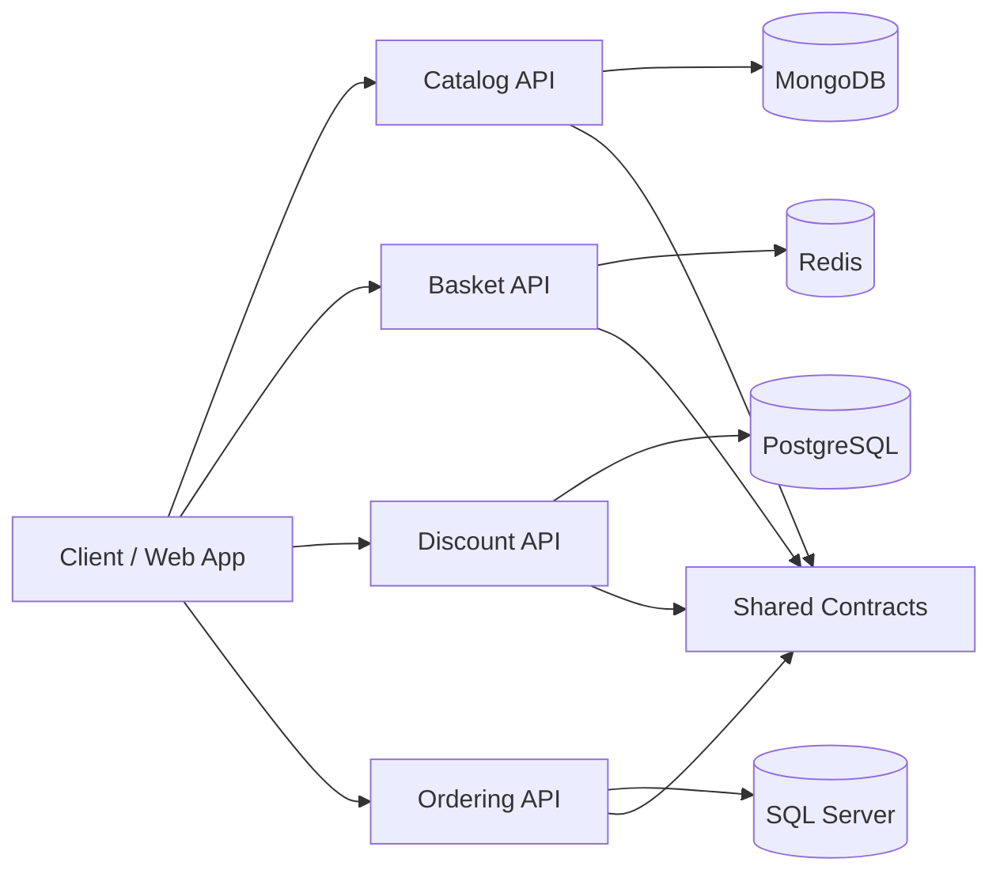

# Ecommerce Microservice App

<div align="center">

[](https://dotnet.microsoft.com/)
[](https://www.docker.com/)
[](https://www.mongodb.com/)
[](https://redis.io/)
[](https://www.postgresql.org/)
[](https://www.microsoft.com/en-us/sql-server)

</div>

<p align="center">
  
</p>

<p align="center">
  <strong>A modern e-commerce backend built with .NET microservices, Docker, and independent data stores.</strong>
</p>

This project is a hands-on learning and portfolio-focused microservices application designed to model a real-world e-commerce ecosystem. It demonstrates how multiple independent services can collaborate to deliver catalog, cart, discount, and order flows while staying loosely coupled and easy to evolve.

## Why this project?

This repository was created to explore and practice:

- microservice architecture in .NET
- service isolation and independent persistence models
- clean layered application design
- Docker-based local development
- API-driven communication between services
- real-world e-commerce business flows

It is intentionally structured to feel like a real backend foundation that can grow into a production-ready commerce platform.

## Project goals

The goal is to build a simple but realistic e-commerce backend with:

- Catalog management
- Basket/cart operations
- Discount/coupon logic
- Order processing
- Swagger-based API documentation
- Service orchestration via Docker Compose

## Architecture overview



The solution is designed around a modular monorepo pattern where each domain owns its own service, infrastructure, and responsibilities.

Each service follows a layered structure:

- Core
- Application
- Infrastructure
- API

This helps keep business logic clean, maintainable, and easy to evolve as the platform grows.

## Tech stack

- .NET 10
- ASP.NET Core
- C#
- Docker & Docker Compose
- MongoDB
- Redis
- PostgreSQL
- SQL Server
- gRPC
- MediatR
- FluentValidation
- Mapster
- Dapper

## Repository structure

```text
ecommerce-microservice-app/
├── Microservices-ECommerce/
│   ├── Services/
│   │   ├── Catalog/
│   │   │   ├── Catalog.API
│   │   │   ├── Catalog.Application
│   │   │   ├── Catalog.Core
│   │   │   └── Catalog.Infrustructure
│   ���   ├── Basket/
│   │   │   ├── Basket.API
│   │   │   ├── Basket.Application
│   │   │   ├── Basket.Core
│   │   │   └── Basket.Infrustructure
│   │   ├── Discount/
│   │   │   ├── Discount.API
│   │   │   ├── Discount.Application
│   │   │   ├── Discount.Core
│   │   │   └── Discount.Infrustructure
│   │   └── Ordering/
│   │       ├── Ordering.API
│   │       ├── Ordering.Application
│   │       ├── Ordering.Core
│   │       └── Ordering.Infrastructure
│   │
│   ├── Inftastructrue/
│   │   └── EventBus.Messages
│   │
│   ├── docker-compose.yml
│   ├── docker-compose.dev.yml
│   ├── docker-compose.prod.yml
│   ├── Microservices-ECommerce.slnx
│   ├── BUILDING_BLOCKS.md
│   └── launchSettings.json
│
├── README.md
├── .gitignore
└── ...
```

## Current services

### Catalog Service
Responsible for product management and catalog-related operations.

Features:

- product listing
- product details
- filtering and metadata queries
- MongoDB-backed persistence

### Basket Service
Handles customer cart functionality.

Features:

- add, remove, and update cart items
- retrieve a cart by username
- shopping cart persistence in Redis

### Discount Service
Manages coupons and discount rules.

Features:

- get discount for a product
- create, update, and delete a coupon
- PostgreSQL-backed storage

### Ordering Service
Manages customer order flow and processing.

Features:

- order creation and tracking
- persistence with SQL Server
- future expansion for payments and order workflows

## Getting started

### Prerequisites

Before running the project, make sure you have:

- Docker Desktop or Docker Engine
- .NET SDK
- Git
- A terminal such as PowerShell, Bash, or zsh

### Clone the repository

```bash
git clone https://github.com/SharaawyMohamed/ecommerce-microservice-app.git
cd ecommerce-microservice-app
cd Microservices-ECommerce
```

### Run the full stack

```bash
docker compose up --build
```

This will start all application services and required infrastructure containers.

## Default ports

After startup, the services are exposed locally at:

| Service | Port | Swagger |
|--------|------|---------|
| Basket API | 8080 | http://localhost:8080/swagger |
| Catalog API | 8081 | http://localhost:8081/swagger |
| Discount API | 8082 | http://localhost:8082/swagger |
| Ordering API | 8083 | http://localhost:8083/swagger |

## Sample endpoints

### Catalog

- `GET /api/catalog`
- `GET /api/catalog/{id}`

### Basket

- `GET /api/basket/{userName}`
- `POST /api/basket`
- `DELETE /api/basket/{userName}`

### Discount

- `GET /api/discount/{productName}`
- `POST /api/discount`
- `PUT /api/discount`
- `DELETE /api/discount/{productName}`

## Local development experience

The project is designed for a smooth local development workflow:

- each service can run independently
- infrastructure dependencies are containerized
- no need to install all external systems manually
- Swagger is available for API exploration
- Docker Compose makes startup fast and repeatable

## Configuration

Services use configuration values from appsettings files and environment variables. Common settings include:

- MongoDB connection string
- Redis connection string
- PostgreSQL connection string
- SQL Server connection string
- gRPC service URLs

These values are wired through Docker Compose for local development.

## Project status

<p align="center">
  
</p>

This project is still under active development, so:

- features are evolving
- architecture may be refined
- some components may be incomplete or experimental
- improvements, refactoring, and additional services are planned

## Roadmap

Planned improvements include:

- centralized API gateway
- authentication and authorization
- health checks
- distributed tracing
- CI/CD pipeline
- automated tests
- event-driven messaging improvements
- better order workflows and payment integration
- more production-ready configuration management

## Why this is a strong portfolio project

This repository demonstrates:

- backend system design thinking
- real-world application structure
- multi-service architecture
- understanding of distributed systems
- containerized development practices
- service-level separation and maintainability
- practical .NET backend experience

For visitors, it clearly communicates that this project is not just a box-ticking demo — it is a backend system built with real engineering principles and software architecture awareness.

## Contributing

Contributions, suggestions, and ideas are welcome. Since the project is still evolving, collaboration is a great way to improve the architecture and quality of the platform.

## License

This project does not currently include a license file. If you plan to share it publicly as a portfolio project or open-source contribution, adding a license such as MIT is strongly recommended.

## Final note

This project reflects a hands-on effort to build an e-commerce backend using modern microservice patterns and .NET tooling. It serves as a strong example of backend engineering, system design, and practical software architecture.

<p align="center">
  
</p>
